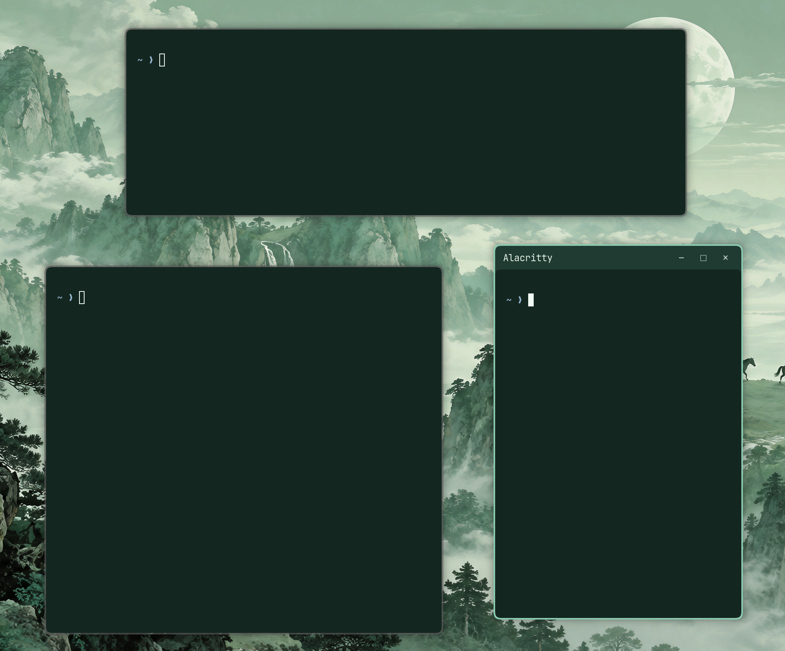

# Konocap

Part of **Konochi**, a personal Omarchy plugin series by Alec Xu.

**Konocap 1.1.0** shows floating-window titlebars **only on the active window**,
sliding them out of—and back into—the window's top edge. No manual Hyprland
configuration or system-file changes.



## Features

- Focus-only titlebars: 180 ms reveal / 120 ms retract, with OutCubic easing.
- Hidden bars reserve no space and accept no clicks; client geometry stays fixed.
- Follows the theme and animation toggle; keeps dragging and window buttons.
- Automatically builds its native extension on first enable.
- Disabling restores stock titlebars; handles reloads, Shell restarts, and crashes.

Applies to Omarchy's titlebars on **floating workspaces**, not application-drawn
titlebars. This is a service plugin, not a Bar widget.

## Install

```sh
omarchy plugin add https://github.com/xvvhang/omarchy-konocap-plugin.git --enable
```

Tested on **Omarchy 4.5.0-3 stable**, Hyprland **0.56.2-4**, and
`omarchy-hyprland-titlebars` **0.2.2-2**. Requires Python 3.9+, CMake 3.27+,
a C++23 compiler, pkg-config, and Hyprland's development dependencies.
Dependencies are not installed automatically; build failures leave stock bars
unchanged. Other Hyprland versions may require source updates.

## Manage

```sh
omarchy plugin enable konochi.konocap
omarchy plugin disable konochi.konocap
omarchy plugin update konochi.konocap
omarchy-shell konochi.konocap status
```

Optional: add `showDuration` and `hideDuration` to the existing `konochi.konocap`
entry in `~/.config/omarchy/shell.json`. Values are milliseconds (0–290); restart
the plugin to apply. Defaults need no configuration.

Builds and logs are cached in `~/.cache/omarchy-focus-titlebars/`. After a Hyprland
upgrade, restart the desktop session before re-enabling the plugin.

## Development

```sh
omarchy plugin validate .
python3 -m unittest discover -s tests -p 'test_*.py'
python3 manager.py --build-only
python3 tests/verify.py /path/to/focus-titlebars.so
```

The regression suite uses a disposable nested Hyprland, never the parent desktop.
It also requires Quickshell, Alacritty, grim, wayland-scanner, and a C compiler.
See [CHANGELOG.md](CHANGELOG.md) for release history.

## License

Integration code: [MIT](LICENSE). Native rendering derives from
[omarchy-hyprland-titlebars](https://github.com/omacom/omarchy-hyprland-titlebars)
v0.2.2; original [BSD-3-Clause](native/LICENSE) and [MIT](native/LICENSE.MIT)
notices are retained.
